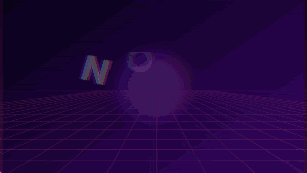
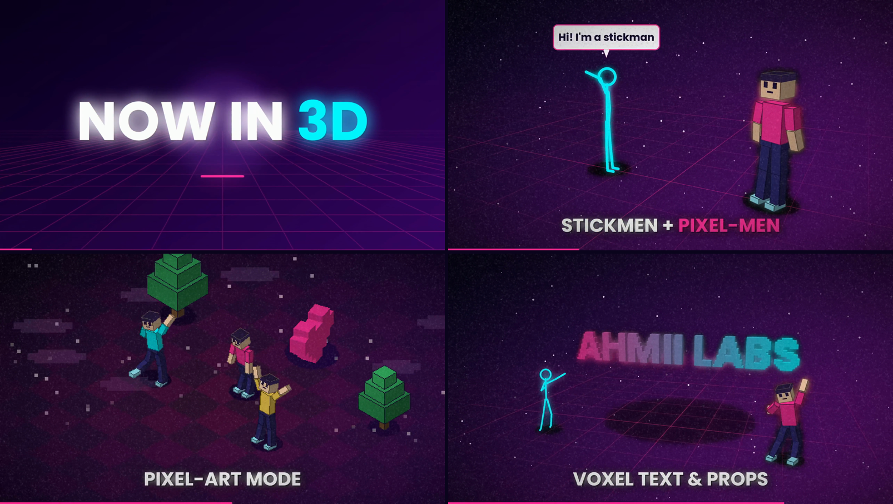
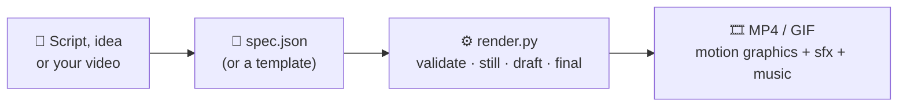
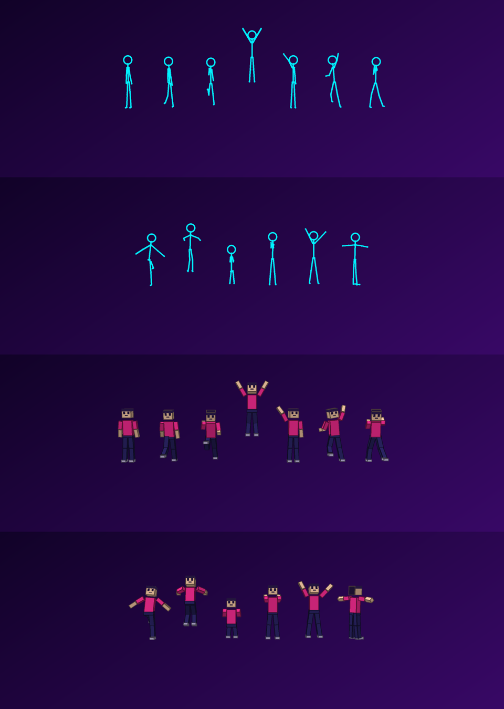
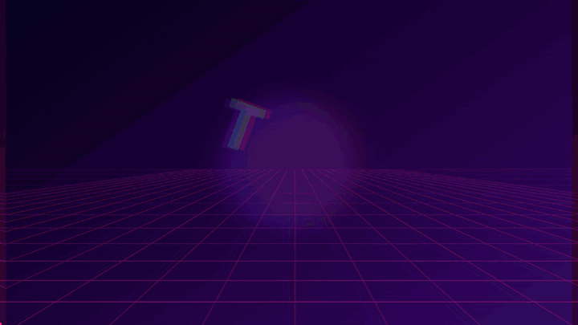
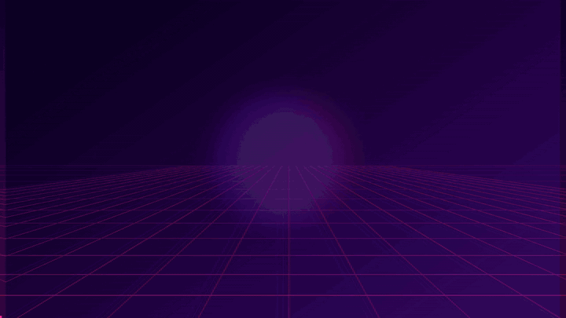

<div align="center">

# 🎬 Motion Video Editor

### Turn a small text file into a motion-graphics video — kinetic typography, glitch & glow, and now **3D stickmen, pixel-men and voxel text**.


<br>



<sub>Everything above was generated from one JSON file: <a href="demo/specs/ahmii_labs_3d_demo.json"><code>demo/specs/ahmii_labs_3d_demo.json</code></a></sub>

<br><br>

**[▶ Watch the full 2K video](demo/videos/ahmii_labs_3d_demo_2k.mp4)**  ·  **[⚡ Quick start](#-quick-start)**  ·  **[🧍 3D stage](#-3d-stage)**  ·  **[✨ Features](#-features)**  ·  **[🖼 Gallery](#-demo-gallery)**

</div>

---

## 🆕 What's new

| | |
|---|---|
| 🧍 **3D stage** | Neon **stickmen**, blocky **pixel-men**, **voxel text**, pixel-art props, 13 motions, speech bubbles, 8 camera views and a retro **pixel-art mode** — a built-in software renderer, no GPU or Blender |
| 🧰 **Templates** | `python scripts/new_video.py stickman_story` — a finished video spec in one command, no JSON writing |
| 🗂 **`--catalog`** | Lists every valid scene type, preset, effect, transition and 3D name |
| 🖼 **`--gif`** | Exports a README-ready animated GIF next to your MP4 |
| 🌌 **New backgrounds** | `matrix` (code rain) and `pixel_sky` (pixel clouds) |
| 🔧 **Smarter `logo_reveal`** | Speeds up automatically for short scenes; `"hold_end": true` keeps the logo on screen |

<div align="center">

</div>

---

## 💡 What is this?

Motion Video Editor turns a **spec** (a small JSON file) into a finished **MP4**. You describe the scenes — the renderer does the animation, effects, transitions and sound.

| Mode | You give it | You get |
|---|---|---|
| ✂️ **EDIT** | An existing video (`input_video`) | Your footage with animated titles, lower thirds, captions (`.srt`), stats, charts, color grade and music on top |
| 🪄 **CREATE** | A script, bullet notes or an idea | A faceless promo / reel / short / explainer / logo sting on animated backgrounds, with optional voice-over |
| 🧍 **3D** | A list of actors (`stickman`, `pixelman`, `voxel_text`…) | Animated 3D characters and text with speech bubbles and camera moves |



---

## ✨ Features

| | |
|---|---|
| 🧍 **3D stage** | Stickmen, pixel-men, voxel text & props, 13 motions, path walking, speech bubbles, `pixel` retro mode |
| 🔤 **Kinetic typography** | 21 text animation presets (tracking, scatter, glitch, mask_up, elastic, drop, spin_in…), per-letter or per-word, highlight colors |
| 🧩 **Motion layers** | Free composition: text, counters, shapes, images, particles, parenting, keyframes, easing curves and expressions |
| 🎛 **15 effects** | glow, rgb_split, glitch, shake, grain, vignette, scanlines, flash, light_leak, zoom_punch… |
| 🎥 **Camera** | push_in, pull_out, pan, drift, handheld, dutch, tilt |
| 🔀 **13 full-frame transitions** | whip, zoom, spin, circle, barn, flash, dip, glitch, blur, pixelate, rgb, push, push_up (+ fade, slide, wipe) |
| 🌌 **8 animated backgrounds** | grid (synthwave), aurora, rays, dots, stars, waves, matrix, pixel_sky |
| 🔊 **Auto sound design** | `"sfx": true` adds whooshes, pops, impacts and risers; music auto-ducks under voice-over |
| 🌍 **Urdu / Hindi / Arabic** | Bundled Nastaliq, Naskh and Devanagari fonts with correct letter shaping — in titles *and* 3D speech bubbles |
| 📐 **Any size** | 720p · 1080p · 1440p (2K) · 2160p (4K), any aspect ratio (16:9, 9:16, 1:1, 4:5, 21:9…) |
| 🛡 **Safe & friendly** | `--validate` lint with "did you mean…?" hints, sandboxed expressions, auto-fit text |

**16 scene types:** `title` `text` `bullets` `quote` `stat` `chart` `steps` `outro` `lower_third` `caption` `image` · `kinetic` `logo_reveal` `ring` `motion` · `world3d`

**9 built-in themes:** `neon` `clean` `sunset` `mono` `forest` `gold` `cyber` `ocean` `rose` — or define your own colors.

---

## 🧍 3D stage

A software 3D renderer (numpy + Pillow — **no GPU, no Blender, no extra installs**). Add a `world3d` scene:

```json
{"type": "world3d", "duration": 4, "view": "three_quarter", "bloom": 0.6, "bg_style": "stars",
 "text": "HELLO 3D", "text_y": 0.9,
 "actors": [
   {"kind": "stickman", "color": [0, 240, 255], "path": [[-4.6, 0], [-1.3, 0]], "walk_speed": 1.8,
    "actions": [{"motion": "walk", "dur": 1.9}, {"motion": "wave"}],
    "say": [{"text": "Hi! I'm a stickman", "start": 2.1, "dur": 2}]},
   {"kind": "pixelman", "x": 1.7, "color": [255, 46, 151], "enter": "drop", "motion": "dance"},
   {"kind": "voxel_text", "text": "AHMII", "size": 0.9, "z": -1.5, "colors": [[255, 46, 151], [0, 240, 255]]}
 ]}
```

| | |
|---|---|
| **Actors** | `stickman` · `pixelman` · `voxel_text` · `voxels` (your own pixel art, extruded) · `cube` `sphere` `pyramid` `tree` `platform` |
| **Motions** | `idle` `walk` `run` `jump` `wave` `dance` `punch` `kick` `flip` `sit` `clap` `victory` `spin` — chain them with `actions`; feet always stay on the floor |
| **Walk a route** | `"path": [[x, z], ...]` — the character turns and walks it, steps synced to the distance |
| **Speech bubbles** | `"say": "Hello!"` — works with Urdu / Hindi / Arabic too |
| **Camera** | `front` `three_quarter` `side` `top` `iso` `orbit` `push_in` `chase`, or your own `yaw / pitch / dist / target` (keyframes + expressions) |
| **Looks** | `floor`: grid / checker / solid · `bloom` neon glow · **`pixel: 4`** retro pixel-art mode · `enter`: pop / drop / spin_in / rise |

<div align="center">
<br>
<sub>The 13 built-in motions on a stickman (top) and a pixelman (bottom)</sub>
</div>

Full guide with every field: **[`references/3d.md`](references/3d.md)**

---

## 🖼 Demo gallery

<table>
<tr>
<td width="50%" align="center">
<br>
<b>Now in 3D</b> · 18 s · 2K<br>
Stickman walk + speech bubbles, pixel-art party, voxel text, logo<br>
<a href="demo/videos/ahmii_labs_3d_demo_2k.mp4">▶ MP4</a> · <a href="demo/specs/ahmii_labs_3d_demo.json">spec.json</a>
</td>
<td width="50%" align="center">
<br>
<b>Text In → Video Out</b> · 13 s · 2K<br>
6 fast cuts, terminal typewriter, EDIT / MAKE cards, logo reveal<br>
<a href="demo/videos/ahmii_labs_text_video_2k.mp4">▶ MP4</a> · <a href="demo/specs/ahmii_labs_text_video.json">spec.json</a>
</td>
</tr>
<tr>
<td width="50%" align="center">
<br>
<b>Cyber intro</b> · 10 s · 2K<br>
Glitch title, kinetic lines, count-up stats, logo<br>
<a href="demo/videos/ahmii_labs_cyber_2k.mp4">▶ MP4</a> · <a href="demo/specs/ahmii_labs_cyber_10s.json">spec.json</a>
</td>
<td width="50%" align="center">
<br><b>Make your own in 3 commands</b><br><br>

```bash
python scripts/new_video.py stickman_story \
  --title "MY BRAND" -o my_video.json
python scripts/render.py my_video.json
```
<a href="#-templates">See all templates</a>
</td>
</tr>
</table>

All demos share one look: cyber purple + neon pink/cyan, grain + vignette, auto sfx, 30 fps, no voice-over.

---

## ⚡ Quick start

**1. Install FFmpeg** (the only non-Python requirement)

| OS | Command |
|---|---|
| Windows | `winget install Gyan.FFmpeg` (then reopen the terminal) |
| macOS | `brew install ffmpeg` |
| Ubuntu / Debian | `sudo apt install ffmpeg` |

**2. Install the Python packages**

```bash
pip install -r requirements.txt
```

**3. Check that everything works**

```bash
python scripts/render.py --doctor
```

**4. Make your first video** (6 seconds, ~20 s to render)

```bash
python scripts/render.py demo/specs/hello_world.json
```

The result is saved to `demo/videos/hello_world.mp4`.

### 🧰 Templates

No JSON writing needed — pick a template, give it your text:

```bash
python scripts/new_video.py --list
python scripts/new_video.py stickman_story --title "MY BRAND" --subtitle "My tagline" -o my_video.json
python scripts/render.py my_video.json --validate
python scripts/render.py my_video.json
```

| Template | What you get |
|---|---|
| `cyber_intro` | 2D kinetic title + three beat lines + logo reveal (~9 s) |
| `stickman_story` | A stickman walks in and waves, a pixel-man replies, logo (~11 s) |
| `pixel_party` | Pixel-art isometric dance party with a spinning heart (~7.5 s) |
| `voxel_logo` | Your title as swaying 3D voxel blocks, then logo reveal (~8 s) |

### 📝 From plain text

```bash
# write your idea in script.txt, then:
python scripts/script_to_spec.py script.txt -o spec.json --aspect 9:16 --theme cyber --style kinetic
python scripts/render.py spec.json
```

### ✂️ Edit your own footage

Put `"input_video": "my_clip.mp4"` in the spec and add scenes with a `start` time (seconds), plus optional `"srt": "captions.srt"`, `"music"` and a color grade. See [`assets/example_edit_video.json`](assets/example_edit_video.json).

---

## 🧾 What a spec looks like

This is the whole `hello_world.json` — two scenes, about 20 lines:

```json
{
  "output": "../videos/hello_world.mp4",
  "aspect": "16:9",
  "resolution": 720,
  "theme": "cyber",
  "bg_style": "grid",
  "sfx": true,
  "fx": [{"type": "vignette"}, {"type": "grain"}],
  "scenes": [
    {"type": "kinetic", "text": "HELLO WORLD", "preset": "tracking", "size": 110,
     "highlight": ["WORLD"], "duration": 2.5,
     "fx": [{"type": "glow", "amount": 0.8}]},
    {"type": "outro", "text": "Made with Motion Video Editor", "subtext": "by Ahmii Labs",
     "animation": "mask_up", "duration": 3.5, "transition": "whip"}
  ]
}
```

Docs: [`references/spec.md`](references/spec.md) (all fields) · [`references/motion.md`](references/motion.md) (motion engine) · [`references/3d.md`](references/3d.md) (3D stage) · [`references/recipes.md`](references/recipes.md) (patterns)

---

## 🛠 Commands

```bash
python scripts/render.py --doctor                    # check FFmpeg, fonts, TTS, CPU cores
python scripts/render.py --catalog                   # list every valid name (presets, fx, transitions, 3D…)
python scripts/render.py spec.json --validate        # lint the spec (no render)
python scripts/render.py spec.json --estimate        # predict the render time
python scripts/render.py spec.json --still 4.5 -o frame.png   # preview one frame
python scripts/render.py spec.json --preview         # quick draft of the first 12 s
python scripts/render.py spec.json --quality draft   # small + fast, for checking pacing
python scripts/render.py spec.json                   # final render
python scripts/render.py spec.json --resolution 4k   # override the size
python scripts/render.py spec.json --gif             # also save a README-ready animated GIF
python scripts/new_video.py --list                   # ready-made templates
```

**Recommended workflow:** `--validate` → `--still` on 2–3 key moments → `--quality draft` → final render.

| You want | Use `resolution` |
|---|---|
| Reels, TikTok, YouTube, Instagram | `1080` (default) |
| Fast / small file | `720` |
| 2K / QHD | `1440` |
| 4K / UHD | `2160` (add `"codec": "h265"` for ~40% smaller files) |

`resolution` is the **short side** in pixels, so it works for any aspect ratio.

### ⏱ How long does a render take?

Measured on a **single CPU core** (more cores = faster, the renderer uses them automatically):

| Video | Time |
|---|---|
| 6 s, 720p (`hello_world`) | ~20 s |
| 13 s, 2K (`ahmii_labs_text_video`) | ~3.3 min |
| 18 s, 2K with 3D scenes (`ahmii_labs_3d_demo`) | ~6 min |

`--quality draft` and 1080p are much faster. `--estimate` is based on 2D frames, so for 3D-heavy videos expect it to be slightly optimistic.

---

## 🤖 Use it with Claude

This repo includes [`SKILL.md`](SKILL.md), so it works as a Claude skill. Describe the video in plain words and Claude writes the spec, previews it and renders it:

> *"Make a 10-second 2K cyber intro for my brand with a glitch title and a logo reveal."*
> *"A stickman walks in, waves and says hello, then a pixel-man replies. Neon style, 16:9."*
> *"Pixel-art isometric dance party, then my title as 3D voxel text."*

See Anthropic's documentation for how to install skills.

---

## 🗂 Project structure

```
motion-video-editor/
├── README.md
├── SKILL.md                 # skill description (for Claude skill use)
├── requirements.txt
├── scripts/
│   ├── render.py            # the renderer (validate / still / draft / final / gif / catalog)
│   ├── new_video.py         # templates  →  spec.json
│   ├── script_to_spec.py    # plain text  →  spec.json
│   ├── tts.py               # optional voice-over (edge-tts / espeak / pyttsx3)
│   └── mve/                 # motion engine
│       ├── geo3d.py         #   software 3D renderer (camera, faces, painter)
│       ├── rigs.py          #   skeleton, 13 motions, stickman / pixelman / voxel meshes
│       ├── stage3d.py       #   the 3D stage layer, actors, camera rig
│       └── …                #   layers, fx, transitions, backgrounds, sfx, fonts
├── references/              # spec.md · motion.md · 3d.md · recipes.md
├── assets/                  # example specs + bundled fonts (Poppins, Noto Nastaliq/Naskh/Devanagari)
├── tests/smoke_test.py      # self-check
└── demo/
    ├── videos/              # the finished 2K demo videos
    ├── previews/            # GIF previews + images used in this README
    └── specs/               # the JSON files that produced the demos
```

---

## 🎙 Voice-over (optional)

Add a `narration` line to any scene and a `"tts"` setting:

```json
"tts": {"lang": "ur"}
```

Natural voices need `pip install edge-tts` and an internet connection. Without a working voice engine the render still completes (silent, same timing) and tells you how to fix it. Urdu and Hindi text is detected automatically.

---

## ⚠️ Limits (honest list)

- **No AI-generated footage and no video clips as layers.** The 3D stage is a lightweight software renderer: flat-shaded stickmen, blocky pixel-men and voxels — no textures, no imported models (FBX/OBJ/GLB), humanoid rig only.
- **No speech-to-text** — for captions on your own footage, supply the lines or a `.srt` file.
- **Up to ~5 minutes** per video. For longer work, split it into parts.
- **Speed depends on CPU cores** — see the table above. Run `--estimate` and `--quality draft` first.
- Social platforms re-encode to 1080p, so 4K mostly matters for YouTube, TV and archiving.

## ❓ FAQ

<details>
<summary><b>Do I need a GPU or Blender for the 3D scenes?</b></summary>
No. The 3D stage is a small software renderer built on numpy and Pillow. It runs on any PC that can run Python and FFmpeg.
</details>

<details>
<summary><b>Does it work on Windows?</b></summary>
Yes. Install FFmpeg with <code>winget install Gyan.FFmpeg</code>, install the Python packages, and run the same commands in PowerShell or Command Prompt.
</details>

<details>
<summary><b>Can it add captions to my own video?</b></summary>
Yes — give it a <code>.srt</code> file in EDIT mode. It cannot transcribe speech by itself.
</details>

<details>
<summary><b>Can I use my own 3D models (FBX / OBJ)?</b></summary>
No. Characters are built in (stickman, pixelman) plus voxel text and voxel pixel-art you can define yourself in the spec.
</details>

<details>
<summary><b>The render is slow. What can I do?</b></summary>
Use <code>--quality draft</code> while you work, 1080p instead of 2K/4K, and keep 3D voxel text short. More CPU cores make the final render proportionally faster.
</details>

---

## ✅ Tests

```bash
python tests/smoke_test.py
```

Checks easing and expression safety, font coverage (Latin, Urdu, Hindi), resolution maths, the 3D camera and every motion (feet on the floor), the templates, and renders the example specs. Prints `ALL OK` when everything passes.

---

## 🙌 Credits

Made with ❤️ by **Ahmii Labs**.

Bundled fonts: [Poppins](https://fonts.google.com/specimen/Poppins) and [Noto](https://fonts.google.com/noto) (Nastaliq Urdu, Naskh Arabic, Sans Devanagari), under the SIL Open Font License — see [`assets/fonts/LICENSE-FONTS.txt`](assets/fonts/LICENSE-FONTS.txt).

---

## 📄 License & Copyright

Copyright © 2026 **Ahmii Labs**. All code in this repository is released under the [MIT License](LICENSE) — you may use, modify and distribute it, as long as the copyright notice and license text are kept.

Third-party components (the bundled fonts) keep their own licenses — see [`NOTICE`](NOTICE). The Ahmii Labs name and branding used in the demo videos remain the property of Ahmii Labs.
